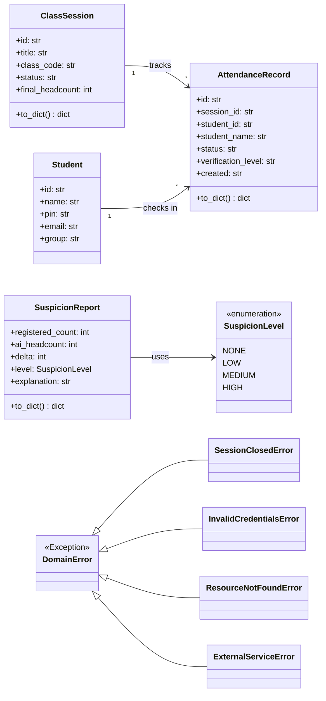
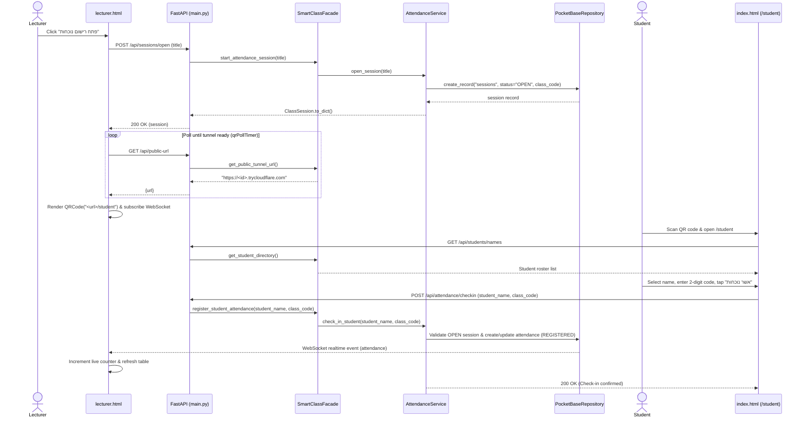
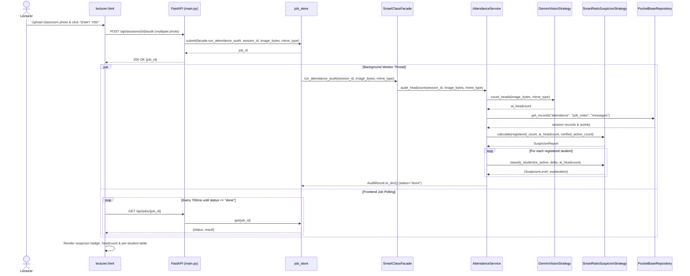
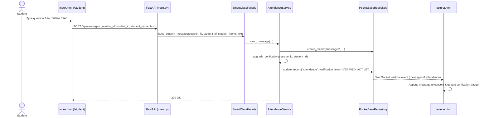
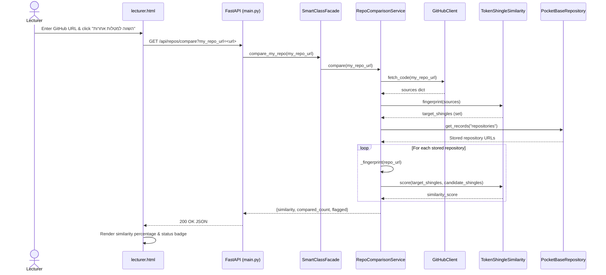

# Low-Level Class & Sequence Diagrams — Smart Classroom

**Project Name:** Smart Classroom — Web-Based Teaching Tool  
**Course:** Introduction to Software Engineering (OOP / OOD) — Ex2  
**Institution:** Ariel University  
**Document Purpose:** Deliverable #8 — Low-level UML Class Diagrams and Runtime Sequence Diagrams aligned 1:1 with `backend/` classes.

---

## 1. Low-Level Class Diagrams

### 1.1 Backend Architecture, Design Patterns & Services
This diagram illustrates the exact classes, interfaces, attributes, methods, and design patterns implemented in `backend/`: **Facade** (`SmartClassFacade`), **Factory** (`SystemFactory`), **Repository** (`IDataRepository` / `PocketBaseRepository`), and **Strategy** (`IHeadcountStrategy`, `ISuspicionStrategy`, `IExportStrategy`, `ISimilarityStrategy`).

```mermaid
classDiagram
    direction TB

    class SystemFactory {
        +bootstrap() SmartClassFacade
    }

    class SmartClassFacade {
        -attendance_service: AttendanceService
        -comparison_service: RepoComparisonService
        +configure(attendance_service, comparison_service) SmartClassFacade
        +get_public_tunnel_url() str
        +import_course_students(csv_path: str) dict
        +get_student_directory() list
        +start_attendance_session(title: str) dict
        +get_current_session() dict
        +register_student_attendance(student_name: str, class_code: str) dict
        +run_attendance_audit(session_id: str, image_bytes: bytes, mime_type: str) dict
        +override_student_attendance(session_id: str, student_id: str) dict
        +finalize_attendance_session(session_id: str, final_headcount: int) dict
        +generate_attendance_report(session_id: str) tuple
        +send_student_message(session_id: str, student_id: str, student_name: str, text: str) dict
        +create_poll(session_id: str, question: str, options: list) dict
        +get_active_poll(session_id: str) dict
        +vote_in_poll(poll_id: str, student_id: str, session_id: str, answer: str, student_name: str) dict
        +get_poll_results(poll_id: str) list
        +import_repos_csv(csv_text: str) dict
        +compare_my_repo(my_repo_url: str) dict
        +repos_status() dict
        +compare_for_student(my_repo_url: str) dict
    }

    class IDataRepository {
        <<interface>>
        +get_records(collection: str, filter_str: str, sort_str: str) list
        +create_record(collection: str, data: dict) dict
        +update_record(collection: str, record_id: str, data: dict) dict
    }

    class PocketBaseRepository {
        -base_url: str
        -admin_email: str
        -admin_password: str
        -_authenticate() str
        -_headers() dict
        -_request_with_retry(method: str, url: str) dict
        +get_records(collection: str, filter_str: str, sort_str: str) list
        +create_record(collection: str, data: dict) dict
        +update_record(collection: str, record_id: str, data: dict) dict
    }

    class AttendanceService {
        -repo: IDataRepository
        -headcount_strategy: IHeadcountStrategy
        -suspicion_strategy: ISuspicionStrategy
        -export_strategy: IExportStrategy
        +import_students_from_csv(csv_path: str) dict
        +list_students() list
        +open_session(title: str) ClassSession
        +get_active_or_latest_session() ClassSession
        +check_in_student(student_name: str, class_code: str) dict
        +audit_headcount(session_id: str, image_bytes: bytes, mime_type: str) AuditResult
        +manual_override(session_id: str, student_id: str) AttendanceRecord
        +close_session(session_id: str, final_headcount: int) ClassSession
        +export_attendance(session_id: str) tuple
        +send_message(session_id: str, student_id: str, student_name: str, text: str) dict
        +create_poll(session_id: str, question: str, options: list) dict
        +get_active_poll(session_id: str) dict
        +submit_poll_vote(poll_id: str, student_id: str, session_id: str, answer: str, student_name: str) dict
        +get_poll_results(poll_id: str) list
        -_collect_activity(session_id: str) dict
        -_upgrade_verification(session_id: str, student_id: str) None
    }

    class AuditResult {
        +report: SuspicionReport
        +students: list
        +to_dict() dict
    }

    class AIService {
        +summarize_content(file_bytes: bytes, mime_type: str) str
        +review_homework(repo_url: str) str
        -_generate_with_retry(contents: list) str
    }

    class RepoComparisonService {
        -repo: IDataRepository
        -github_client: GitHubClient
        -similarity_strategy: ISimilarityStrategy
        +import_repos_csv(csv_text: str) dict
        +count() int
        +compare(my_repo_url: str) dict
        +compare_for_student(my_repo_url: str) dict
        -_fingerprint(url: str) set
    }

    class GitHubClient {
        -token: str
        +parse_repo_url(url: str) tuple
        +fetch_code(url: str) dict
        -_headers() dict
        -_get(url: str) dict
    }

    class IHeadcountStrategy {
        <<interface>>
        +count_heads(image_bytes: bytes, mime_type: str) int
    }

    class GeminiVisionStrategy {
        -api_key: str
        -model_name: str
        +count_heads(image_bytes: bytes, mime_type: str) int
        -_generate_with_retry(contents: list) str
    }

    class MockHeadcountStrategy {
        -fixed_count: int
        +count_heads(image_bytes: bytes, mime_type: str) int
    }

    class ISuspicionStrategy {
        <<interface>>
        +calculate(registered_count: int, ai_headcount: int, verified_active_count: int) SuspicionReport
        +classify_student(is_active: bool, delta: int, ai_headcount: int) tuple
    }

    class SmartRatioSuspicionStrategy {
        +calculate(registered_count: int, ai_headcount: int, verified_active_count: int) SuspicionReport
        +classify_student(is_active: bool, delta: int, ai_headcount: int) tuple
    }

    class IExportStrategy {
        <<interface>>
        +media_type() str
        +file_extension() str
        +export(students: list, records: list, session_id: str) bytes
    }

    class ExcelExportStrategy {
        +media_type() str
        +file_extension() str
        +export(students: list, records: list, session_id: str) bytes
    }

    class ISimilarityStrategy {
        <<interface>>
        +fingerprint(sources: dict) set
        +score(a: set, b: set) float
    }

    class TokenShingleSimilarity {
        -k: int
        +fingerprint(sources: dict) set
        +score(a: set, b: set) float
        -_normalize(code: str) list
    }

    SystemFactory ..> SmartClassFacade : bootstraps
    SystemFactory ..> PocketBaseRepository : creates
    SystemFactory ..> AttendanceService : creates
    SystemFactory ..> RepoComparisonService : creates

    SmartClassFacade --> AttendanceService : delegates
    SmartClassFacade --> RepoComparisonService : delegates

    IDataRepository <|.. PocketBaseRepository : implements
    IHeadcountStrategy <|.. GeminiVisionStrategy : implements
    IHeadcountStrategy <|.. MockHeadcountStrategy : implements
    ISuspicionStrategy <|.. SmartRatioSuspicionStrategy : implements
    IExportStrategy <|.. ExcelExportStrategy : implements
    ISimilarityStrategy <|.. TokenShingleSimilarity : implements

    AttendanceService --> IDataRepository : persists via
    AttendanceService --> IHeadcountStrategy : uses
    AttendanceService --> ISuspicionStrategy : uses
    AttendanceService --> IExportStrategy : uses
    AttendanceService ..> AuditResult : returns

    RepoComparisonService --> IDataRepository : persists via
    RepoComparisonService --> GitHubClient : fetches code via
    RepoComparisonService --> ISimilarityStrategy : scores via
```

---

### 1.2 Domain Models & Custom Exception Hierarchy (`backend/models/`)
This diagram details the domain entities (`domain.py`) and custom domain exception hierarchy (`exceptions.py`).

---

## 2. Low-Level Sequence Diagrams

### 2.1 Session Opening, QR Sync & Real-Time Student Check-In (UC-01 & UC-02)

---

### 2.2 Asynchronous AI Vision Headcount & Suspicion Auditing (UC-03)

---

### 2.3 Live Student Q&A & Verification Upgrade (UC-05)

---

### 2.4 GitHub Repository Similarity Comparison (UC-08)

